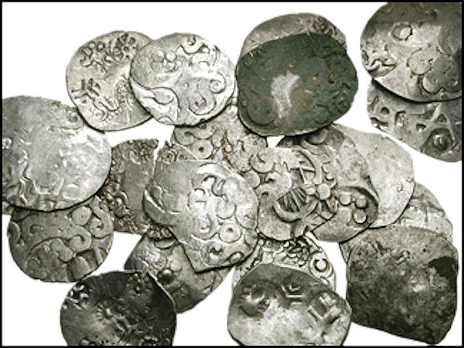

# Kahāpaṇa

**Kahāpaṇas from Kosala. Circa 525-465 BC.**

Average diameter 25mm, average weight 2.70 g. Each piece with a variety of separate punch-marks applied to both sides.

1 kahāpaṇa = 4 pāda

1 pāda = 5 māsaka

**Fun Indo-European Etymology Story[^27]**

The Sanskrit word for kahāpaṇa is *kārṣāpaṇa*.

The coins were called *kārṣāpaṇa* because they weighed one *karṣa* each, a weight measured in cowrie shells.

The English word, "Cash", seems similar to the Sanskrit word, *karṣa*.

[^27]: Please understand that this is meant as a humorous element.
